# A patient’s journey through HIMS — from first admission to discharge

Status: Final implemented synthetic screenshots reconciled

## A patient’s journey through HIMS — from first admission to discharge

An illustrated guide for the owner and hospital staff

Follow Kavita Rao, a fictional 42-year-old patient, from her first registration to her departure. Her cousin Meera helps with paperwork and payments. Every person, identity, time, amount and screen record in this guide is illustrative or synthetic.

HIMS gives each staff role the information and actions needed for its work. The story explains who records a fact, what the next person sees and why an unfinished task remains visible. It provides no diagnosis, medicine choice or treatment advice.

The clinical destination and care decisions come from clinicians. Insurance decisions are verified outside HIMS. Money follows configured deterministic rules. Professional clearances come from the responsible humans.

Read the story in order, then use the money, self-pay and missing-evidence pages when a case does not follow the happy path. The example is one hospital’s staff-facing HIMS, not a universal hospital discharge policy.

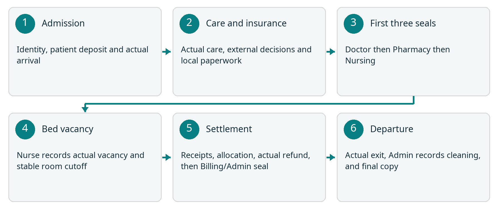
Story map. After the first three professional seals, actual Nurse-recorded bed vacancy gives Billing a stable room cutoff. Final settlement precedes the Billing or Admin seal and actual departure. Care and insurance work can proceed alongside one another.

This product’s insurer-money gate, room-charge cutoff and staff sequence are HIMS rules. Real hospital policies, tariffs, access, retention and operating arrangements still need approval before real use.

## The eight staff roles

These fictional colleagues share one admission episode. A worklist or visible button never grants permission; HIMS checks the signed-in role and current patient or case assignment on the server.

| Role and colleague | What they record | What passes forward |
| --- | --- | --- |
| Admission / Ritu Shah | Find or create UHID; create IP episode; record clinician intake, reservation, patient deposit and actual activation. | Doctor and assigned ward team see the active episode. |
| Doctor / Dr Arjun Sen | Sign rounds, clinical orders, transfer decisions, summary and prescription; issue Doctor clearance. | Nursing, Pharmacy and Lab receive their own linked work. |
| Nursing / Nisha Thomas | Record attendance, observations, MAR, consumables and handover; attest actual moves and bed vacancy; sign Nursing clearance. | The next shift sees unfinished work; Billing sees relevant operational completion. |
| Pharmacy / Farah Ali | Record actual stock issues and returns; prepare take-home medicines against the signed prescription; sign Pharmacy clearance. | Nursing sees issued medicine work; Billing sees source-linked charges. |
| Lab and radiology / Om Patel | Track the ordered test, sample or processing, human report and addenda; resolve source-linked fee gaps. | The assigned Doctor sees the report; Billing sees its charge status. |
| Insurance / Sana Khan | Record externally verified policy and payer decisions; review local manual paperwork and follow-up. | Billing sees verified responsibility separately from actual receipts. |
| Billing / Amit Das | Reconcile charges and party responsibility; record actual receipts, allocate original cash and record actual refunds; sign final clearance. | Discharge can proceed only against current reviewed sources and settlement. |
| Admin / Dev Mehta | Configure approved rules, manage beds and assignments, record accountable exceptions, final departure, cleaning evidence and documents. | The bed becomes reusable after recorded cleaning; historical sources remain. |

Kavita and Meera are not staff roles. This version has no patient portal. Staff explain care, bills and paperwork through the hospital’s normal communication channels.

Admin manages access and exceptions, but does not become a Doctor, Nurse or Pharmacy signer. Admission creates new episodes; Admission or Admin activates them. Billing settles money and cannot activate an episode.

## 1 Admission records the first visit

On fictional Day 1 at 09:00, Ritu looks for Kavita’s existing identity. This is her first visit, so Ritu creates a permanent UHID. She creates a separate IP code for this particular stay. A later admission will reuse the UHID and receive a new IP code.

A clinician has assessed Kavita and supplied the destination and admitting Doctor. Ritu records that assessment’s source, selects an available configured bed and saves the episode. Its status is PENDING: the bed is reserved, but Kavita has not yet started an occupied stay.

Meera pays an illustrative ₹30,000 patient deposit through an existing hospital channel. Ritu records the actual receipt, mode, reference, time and evidence. The example assumes the hospital’s configured fixed deposit requirement has been met; ₹30,000 is not a recommended tariff.

At 09:40 Kavita actually starts using the bed. Ritu activates the reservation with that factual occupancy time. HIMS starts an ADMITTED stay with the applicable tariff version. Saving a reservation or insurer approval would not have started room charging.

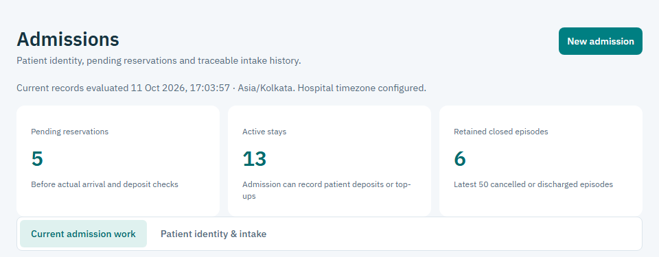
Admission workspace excerpt from the tested synthetic application. Its counts and screen records are separate from Kavita’s fictional story.

Handoff: Dr Arjun sees his admitted patient. The assigned ward team sees its nursing work. The original receipt remains identifiable for later allocation or refund. Missing or unconfigured policy is shown as a blocker, never silently treated as zero.

## 2 The Doctor creates care work

Dr Arjun opens his Patients workspace and Kavita’s episode. He records a signed round note and the clinical orders he decides are needed. HIMS does not decide diagnosis, urgency, medicine, dose or clinical destination.

Orders pass into the relevant staff worklists: an ordered test goes to Lab, ward medicine creates Pharmacy work and explicitly scheduled nursing occurrences, and an observation order appears in nursing work. Take-home-only medicine creates no ward MAR schedule.

Dr Arjun selects configured medicine identity and the required clinical details. Pharmacy cannot replace that identity by guessing from free text. HIMS does not invent a schedule for unsupported PRN or as-needed ward instructions.

If Dr Arjun corrects a signed note, he adds a signed addendum with a reason. If he stops an order, that stop remains attributable. The original note and order stay in history. Department work already performed is not erased by a later stop.

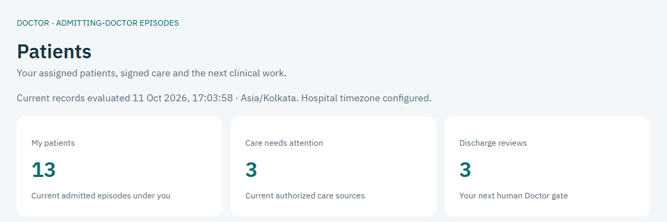
Doctor Patients workspace excerpt from the tested synthetic application. Its work counts are separate from Kavita’s fictional story.

Handoff: the next staff member sees a source-linked task rather than a copied instruction. A missing price can leave billing work unresolved while the clinical record itself remains retained.

## 3 Nursing records what actually happened

Nisha begins her recorded shift and works on currently assigned patients. In My shift, she opens Kavita’s scheduled observations and medicines. She records the actual reading or event time and her own signature.

For medicine, the MAR records the prescribed occurrence, actual dose and unit, actual time, and GIVEN, HELD or REFUSED outcome. A held or refused dose needs a reason. The story includes no medicine or dose recommendation.

Pharmacy issuing stock and Nisha giving a dose are different facts. Nursing administration does not add a second medicine charge. Consumables record the episode and the bed or stay where they were used.

At the end of the shift, Nisha records its factual end and handover. The next assigned Nurse sees remaining and overdue occurrences. A new shift does not erase them. Factual late entries and corrections retain actual-care time separately from later signing time.

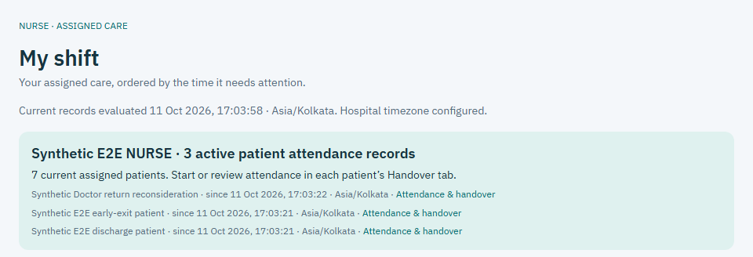
Nursing workspace excerpt showing actual synthetic attendance records. These test patients are separate from Kavita’s fictional story.

Handoff: the next Nurse sees pending care and handover history. A financial clearance does not end nursing attendance or prescribed monitoring; later actual care can require a fresh dependent review.

## 4 Pharmacy fulfills and reconciles medicine

Farah opens the medicine work created by Dr Arjun’s persisted order. She checks the selected medicine, usable batch, expiry and exact dispensing unit. HIMS refuses expired stock, a mismatched barcode or an invented conversion between units.

Farah records the actual quantity issued to Kavita’s episode. The stock movement and its source-linked medicine charge are recorded together. A repeated request cannot create a second issue or charge.

Unused stock returned through the hospital’s actual process is recorded against the original issue. The linked return preserves quantity, original rate and financial history; it does not overwrite the original movement.

Near discharge, Farah prepares take-home medicines against the latest signed prescription and reconciles ward issues, returns and administration records. Preparation, patient collection and Pharmacy clearance are distinct facts. The software does not automatically confirm collection.

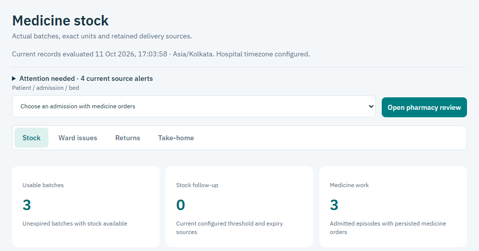
Pharmacy Stock tab from the tested synthetic application. Its batches and work counts are separate from Kavita’s fictional story.

Handoff: Nursing can record actual administration, and Billing sees the source-linked issue or return. Formal Pharmacy signing waits for the current Doctor clearance, even if preparation started earlier. A signed empty prescription still needs Pharmacy review.

## 5 Lab links the sample and human report

Om sees Kavita’s Doctor-ordered test in the Lab worklist. For a specimen-based test, collection creates one stable sample identity and barcode linked to the order, patient and IP episode.

Om checks or enters that persisted barcode before processing and reporting. HIMS rejects another patient’s sample, another order’s label or an unknown barcode. The barcode is an identity check, not a diagnosis.

Om records actual processing and the human-authored result. For radiology, staff record processing and the human report without inventing a specimen. The original report is retained; a correction adds attributable text and a reason.

Completing the report finalizes its original pending economic source once. If the price is unavailable, the report remains and an explicit financial task needs resolution. A later tariff change cannot silently reprice the original order.

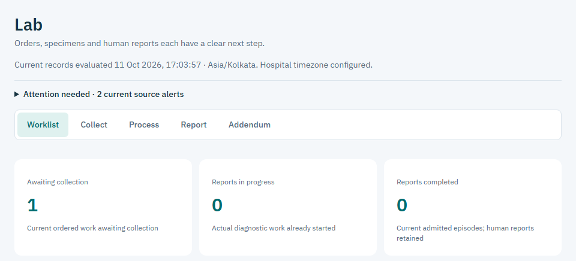
Lab Worklist tab from the tested synthetic application. Its test counts are separate from Kavita’s fictional story.

Handoff: Dr Arjun sees the actual human report and addenda in his scoped patient history. Billing sees its fee status. Instrument integration, automated interpretation and protected report-file attachment are not claimed by this text-report workflow.

## 6 Insurance records external decisions

Sana works on Kavita’s assigned insurance case. She records policy details and validity verified outside HIMS, the external verifier, time, reference and evidence. Insurer or TPA email and portal activity remains with staff in existing channels.

Sana records pre-authorization, enhancement or appeal results with their actual PENDING, APPROVED, PARTIAL or REJECTED status. Earlier decision versions remain. Staff resolve verified responsibility against the current bill; a limit alone does not determine every payable charge.

For this fictional final bill, the externally verified insurer responsibility is ₹90,000 and the patient responsibility is ₹25,000. Both amounts belong to the ₹1,15,000 net bill. They are examples, not a policy promise.

The current paperwork path uses protected case documents and staff-supplied manual text. Sana chooses Prepare manual draft, checks quotations and local gaps, then accepts, requests changes or rejects. Acceptance records a reviewed local packet and follow-up; it does not transmit documents or approve coverage.

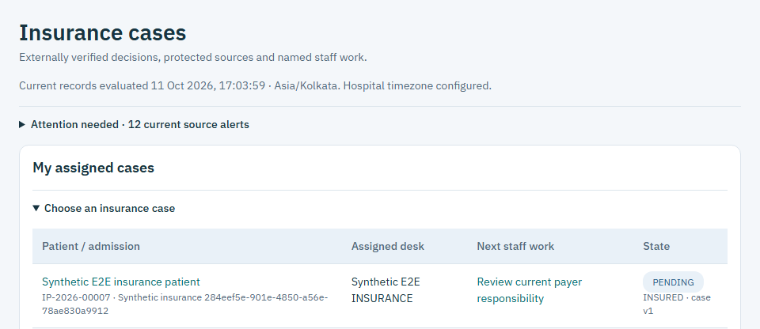
Insurance assigned-case worklist from the tested synthetic application. The visible test patient is separate from Kavita’s fictional story.

Handoff: Billing sees the current responsibility split, actual receipts and outstanding amounts separately. No live AI/OCR provider, autonomous sender, insurer connector or payment connector is implied. TPA means a third-party administrator engaged by an insurer for administrative health services [2].

## 7 A transfer keeps an exact boundary

On fictional Day 2, Dr Arjun decides that Kavita should move to a different configured room category. He records the transfer decision and reason. HIMS checks the destination bed’s availability; Admin cannot substitute for his professional decision.

The assigned Nurse records the actual move and handover at 11:20. The old stay ends exactly at 11:20 and the new stay begins at 11:20. Each segment keeps its original tariff version, so there is no invented gap or double-counted room interval.

Existing orders, scheduled occurrences, MAR and overdue work survive the move. Consumables retain where they were used. A backdated move that overlaps another patient’s bed use or contradicts already posted history is refused.

Because Kavita is insured, the move creates a local Insurance follow-up task. Sana checks the implications externally and records the same-case decision and task resolution. The task itself does not contact a payer or extend coverage.

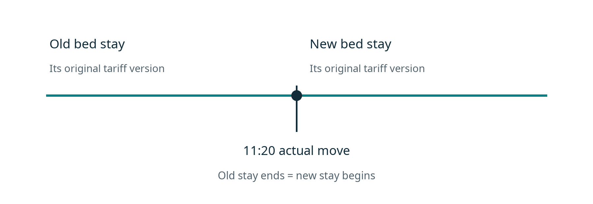
Illustrative actual move at 11:20. Both room segments meet at the same factual boundary; their pinned tariff versions remain distinct.

Handoff: the ward team sees the new location and retained care work. Billing sees the two source-linked room segments. Unsupported historical boundary corrections require the attributable exception route instead of silently editing the stay.

## 8 Four humans review the current sources

On fictional Day 3, Dr Arjun records the signed discharge summary and explicit take-home prescription, including his own advice and follow-up instructions. Staff explain the clinician’s recorded plan to Kavita. This guide does not supply clinical advice.

Ordinary formal clearance follows Doctor, then Pharmacy, then Nursing, then Billing or Admin. Staff may prepare beforehand. Each seal names its signer and binds the information actually reviewed; Admin cannot issue another profession’s seal.

Doctor reviews the clinical sources. Pharmacy reviews medicine fulfillment and reconciliation. Nursing reviews the chart, actual administration, consumables, attendance and handover. Billing reviews the current bill, responsibility, actual money and unresolved work.

Changed information can make a seal stale. A money change normally reopens Billing; a medicine or MAR change reopens Pharmacy and its successors; a clinical source change reopens Doctor and dependent reviews. Earlier signatures remain in history.

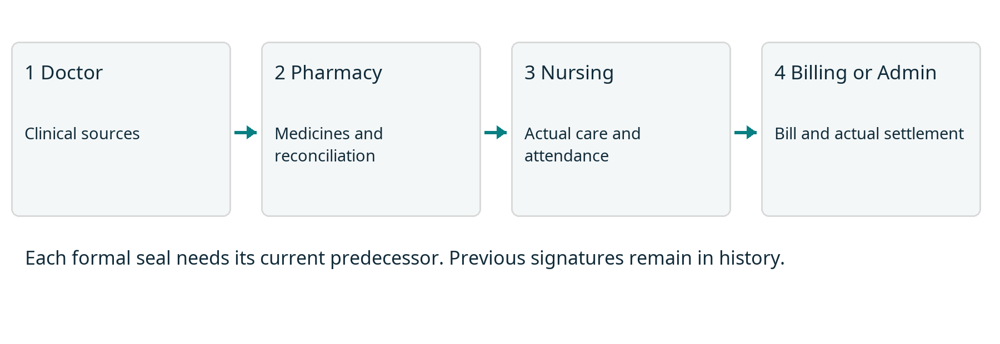
This HIMS’s ordinary human clearance sequence. A current predecessor is required before the next formal seal.

At Day 3 at 13:00, after the first three current seals, the assigned Nurse records Kavita’s actual bed vacancy, waiting location and handover. HIMS closes bed use and catches up room charges to that exact cutoff. The episode and bed hold remain while Billing reviews the stable actual room amount.

Handoff: Nursing clearance covers its reviewed records and hours; it does not stop prescribed care. Later actual care can require a fresh dependent review. The first three current seals are also prerequisites for reviewed allocation correction and actual refund work.

## 9 Billing reconciles actual money

Amit checks the current posted charges, any reversals, room segments and unresolved items. For this example the reviewed net bill is ₹1,15,000. The verified split is insurer ₹90,000 and patient ₹25,000.

The hospital actually receives ₹90,000 from the insurer through an existing channel. Amit records its receipt and evidence. Authorization alone leaves that ₹90,000 outstanding in this HIMS; no receipt is invented from an approval.

The original patient deposit is ₹30,000. Amit allocates ₹25,000 of that existing receipt to the patient’s bill share. Allocation adds no cash. After the required current clinical reviews and bill review, staff actually return ₹5,000 and record the source-linked refund and evidence.

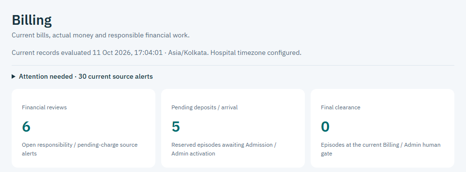
Billing workspace excerpt from the tested synthetic application. Its work counts are separate from Kavita’s fictional bill calculation.

| Illustrative ledger fact | Amount |
| --- | --- |
| Net bill | ₹1,15,000 |
| Verified insurer share and actual insurer receipt | ₹90,000 |
| Verified patient share and deposit allocation | ₹25,000 |
| Original actual patient deposit | ₹30,000 |
| Actual refund against that deposit | ₹5,000 |
| Cash retained after refund | ₹1,15,000 |

Check: ₹90,000 + ₹30,000 − ₹5,000 = ₹1,15,000 retained. Patient balance and insurer balance are zero, with no held excess. These numbers explain the records; they do not set hospital prices.

## 10 Departure cleaning and final documents

The Nurse has already recorded actual bed vacancy at 13:00. Amit has now finished the stable bill, source allocations and actual refund. With all current obligations resolved, Billing or Admin issues final financial clearance. A seal alone does not free a bed.

At 14:10 Kavita actually leaves the hospital. Authorized staff record that separate departure. HIMS rechecks current sources, clearances, medicine safety and settlement, closes the episode, releases its hold once and creates a cleaning task.

The real cleaning work happens outside the application. Admin records confirmed cleaning completion and evidence through the Discharge screen. The bed becomes usable for another reservation or transfer only after that turnover is recorded.

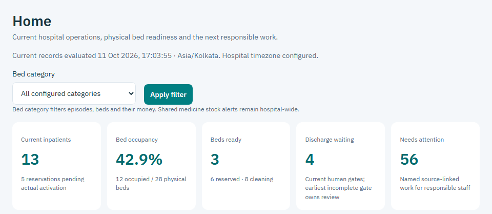
Admin Home excerpt showing actual synthetic physical bed counts. These test beds and counters are separate from Kavita’s fictional story.

Admin or Billing creates the final discharge copy after recorded departure. Staff can open its HTML view, print view and authenticated PDF download. The copy retains clinical instructions, financial facts, actual clearances or exception authority, departure and document version. Authorized historical PDFs stay retained when later reviewed amendments produce a new copy. Its verification view requires access; it is not a public patient record.

Actual bed-use time is this implementation’s room-charge basis. A hospital that charges until door exit needs an approved revised charging contract before real financial use.

## 11 When the stay is self pay

Kavita’s clinical work and human professional reviews would stay the same on a self-pay route. Admission still records patient identity, a separate IP code, the configured deposit and actual activation. Doctor, Nursing, Pharmacy and Lab still record their own actual work.

Insurance authorization and insurer receipt are not required for an ordinary self-pay discharge. Billing reviews patient responsibility and actual patient money. No Insurance transfer-follow-up task is created solely for a self-pay move.

| Same illustrative net bill | Insured story | Self pay alternative |
| --- | --- | --- |
| Net bill | ₹1,15,000 | ₹1,15,000 |
| Insurer responsibility | ₹90,000 | ₹0 |
| Patient responsibility | ₹25,000 | ₹1,15,000 |
| Original patient deposit | ₹30,000 | ₹30,000 |
| Additional patient top-up receipt | ₹0 | ₹85,000 |
| Patient amount allocated | ₹25,000 | ₹1,15,000 |
| Patient actual refund | ₹5,000 | ₹0 |

The self-pay column is a separate alternative, not an extra transaction in the insured story. Admission records the additional actual ₹85,000 receipt as a TOP_UP. Amit in Billing allocates ₹30,000 from the original deposit and ₹85,000 from that top-up, each against its own original receipt. Together they apply ₹1,15,000 of existing patient cash to the bill; allocation adds no new cash, and no excess remains to refund.

If an insured case later converts to self-pay, Admin or Billing records the verified external decision, reason and responsibility review. Original authorizations, insurer cash, deposits and refunds remain visible. Conversion cannot erase money or manufacture coverage.

## 12 When evidence or money is missing

If the insurer has approved ₹90,000 but has paid nothing, Sana follows up through the existing insurer or TPA channel. Amit leaves insurer due at ₹90,000. This HIMS blocks ordinary insured financial clearance until the owed money is actually received and evidenced. That is a configured product gate, not a universal legal or hospital rule.

If a policy decision, responsibility split, receipt reference or document is missing or stale, the relevant staff member records the actual evidence or obtains a fresh review. A manual paperwork draft only identifies local gaps. It cannot prove eligibility, satisfy payer requirements or send the packet.

If a department charge lacks price configuration, the responsible staff resolve the source-linked task with proper authority. If a sample or medicine identity does not match, the operational action stops for correction. Staff do not invent a zero price, completed test or substituted medicine.

If urgent arrival, delayed insurer funds, agreed credit, an unavailable professional or an early exit needs an exception, Dev records the specific authority, reason, evidence and follow-up owner. Proper professionals record clinical or physical facts. Missing seals and unpaid obligations remain visible.

Later collection must be an actual receipt. Later financial correction must be a linked adjustment or reversal. A follow-up note is neither. Original departure, receipts, professional records and final document versions stay retained.

Kavita’s fictional ordinary story reaches zero dues and recorded departure. A real unresolved case follows its recorded current state; no staff member or AI can label it settled merely to move the screen forward.

## Words used in the guide

| Word | Plain meaning in this guide |
| --- | --- |
| UHID | The permanent hospital patient identity. It can link more than one admission. |
| IP code | The unique inpatient episode code for this stay. Cancellation does not reuse it. |
| Pending reservation | A saved episode holding a bed before actual activation. It starts no room charge. |
| MAR | Medication administration record: what happened to a prescribed occurrence and who recorded it. |
| Addendum | An attributable correction or addition that keeps the original signed record. |
| TPA | Third-party administrator engaged by an insurer for administrative health services [2]. |
| Authorization | The externally verified payer decision or limit. It is separate from cash received. |
| Receipt | A record of money actually received through an existing hospital channel. |
| Allocation | Applying already received money to bill responsibility. It creates no new cash. |
| Refund | Money actually returned, linked to its original receipt and reviewed excess. |
| Clearance or seal | A responsible human’s recorded review of current sources, with signer and time. |
| Turnover | The required bed cleaning work and its recorded actual completion evidence. |

General context [1]: discharge planning and the patient’s discharge information are part of coordinated hospital care, but hospitals have their own discharge policies. The NHS source is background from England, not authority for Indian financial or discharge rules.

[1] NHS, Being discharged from hospital. https://www.nhs.uk/nhs-services/hospitals/going-into-hospital/being-discharged-from-hospital/ (checked 11 October 2026).

[2] IRDAI, Health department FAQ, question 41 on TPA and insurer. https://irdai.gov.in/health-dept (terminology reference checked 11 October 2026).

HIMS-specific source: approved UI redesign handoff and design reference, with Admission, Care, Transfers, Pharmacy, Lab, Insurance, Paperwork, Billing, Discharge, Documents and Exceptions contracts in this repository. Current role authority in the approved handoff overrides historical wording.
