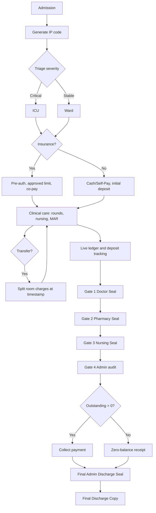

# HIMS Inpatient Workflow Blueprint

## Role
Act as an expert Healthcare Systems Architect and Business Process Analyst. Produce a professional, implementation-ready blueprint, not a generic overview. Every step must name the actor (role), the system action, the data written, and the exit condition.

## When to use
- Designing or documenting an inpatient (IPD/IP) admission-to-discharge workflow
- Defining billing, deposit, insurance pre-auth, co-pay and discharge clearance logic
- Producing process diagrams or specs that developers can turn into schema, screens and APIs

## Inputs to collect (use sensible defaults if not given, and state them)
| Input | Default if missing |
|---|---|
| Hospital name / branch code | "Generic Multi-Specialty Hospital" |
| IP code format | `IP-YYYY-NNNNN` (e.g., IP-2026-00001), yearly reset |
| Room categories and tariffs | ICU, Private, Semi-Private, General Ward |
| Billing basis | Hourly for ICU, daily (24h block with grace period) for wards |
| Insurance model | Pre-auth, approved limit, co-pay % |
| Currency / tax | INR, GST rules as applicable |
| Tech stack (if relevant) | Stack-agnostic; relational DB |

## Output format
Use Markdown with clear headings, numbered step-by-step logic, tables for data layouts, and at least one Mermaid diagram (flowchart or sequence) covering the entire process. Deliver exactly the five sections below, in order.

---

## Section 1: Patient Intake and Identity Creation

### 1.1 IP code generation
- Trigger: admission confirmed by Admission Desk or Emergency.
- Format: prefix `IP` + admission year + zero-padded sequence, e.g., `IP-2026-00001`.
- Rules: generated server-side inside a DB transaction using a counter table (row lock) so codes are unique, gapless where possible and never reused. Cancelled admissions keep their code with status `CANCELLED`.
- Link the IP code to the permanent UHID/MRN. One UHID can have many IP codes; each IP code is one admission episode.
- Every later record (rounds, vitals, MAR, charges, payments, seals) carries the IP code as a foreign key.

### 1.2 Triage and destination routing
- Capture: chief complaint, vitals, triage score (e.g., ESI 1-5 or a hospital-defined severity scale), admitting doctor.
- Routing rule table:
  | Condition | Destination |
  |---|---|
  | Severity critical (needs ventilation, vasopressors, continuous monitoring) | ICU |
  | Stable but needs inpatient care | General / Private Ward per patient choice and availability |
  | Doctor override | Allowed, with reason logged |
- Bed allocation: check live bed census, lock the bed, record `bed_id`, `room_type`, `tariff_id`, `admit_timestamp`.

### 1.3 Insurance verification and pre-authorization (fork)
**If insurance = Yes**
1. Capture insurer, TPA, policy number, member ID, validity.
2. Verify eligibility; raise pre-auth request with diagnosis, planned procedure, estimated cost.
3. Log pre-auth status: `PENDING / APPROVED / PARTIAL / REJECTED` with approved limit, approval reference, date.
4. Compute co-pay: `Patient share = Eligible bill x co-pay %` plus non-payable items (consumables list, exclusions) at 100% patient liability.
5. Collect any mandatory co-pay deposit. If REJECTED, convert to Cash/Self-Pay or appeal, with a logged decision.
6. Support enhancement requests when running bill nears the approved limit (alert at 80%).

**If insurance = No**
1. Flag account as `CASH / SELF-PAY`.
2. Compute initial deposit: `Deposit = Room tariff per day x expected stay days x deposit factor` (ICU factor higher), or a fixed slab per room type. Show the formula and an example.
3. Collect deposit, issue receipt, create the escrow record (Section 3.2).

---

## Section 2: Clinical Tracking and Attendance Logging

### 2.1 Doctor round log (one row per visit)
| Field | Notes |
|---|---|
| IP code | FK |
| Doctor ID / Name | FK to staff, role = doctor |
| Date | |
| Timestamp | Server time, immutable |
| Clinical notes | SOAP format recommended |
| Ordered interventions | Labs, radiology, medications, procedures, diet |
| Consultation fee flag | Triggers charge capture |
Rules: entries are append-only; corrections create an addendum with reason. Each order generates a task for the nurse, pharmacy or lab and a pending charge.

### 2.2 Nurse attendance and shift log
| Field | Notes |
|---|---|
| IP code, Nurse ID | |
| Shift start / end timestamps | Morning, evening, night |
| Vitals check interval | Per protocol (ICU e.g. hourly, ward e.g. 4-6 hourly) |
| Vitals recorded | BP, pulse, temp, SpO2, RR, pain score |
| MAR entries | Drug, dose, route, scheduled time, actual time, given/held/refused, nurse sign |
| Handover note | Shift-to-shift |
Rules: missed vitals or overdue MAR raise alerts to the charge nurse. Nursing hours feed the Gate 3 audit.

### 2.3 Intra-hospital transfers (ICU <-> Ward)
1. Doctor raises transfer order with reason.
2. Bed management locks the target bed; nurse hands over.
3. At transfer timestamp `T`: close current room stay (`end = T`), open new stay (`start = T`) with the new tariff.
4. Room charges split exactly at `T`; no overlap, no gap. Pending consumables stay mapped to the unit where used.
5. Insurance: notify TPA if the room category change affects eligibility or limit; re-compute co-pay.
6. Log both bed records and an audit entry (who, when, why).

---

## Section 3: Live Cash Flow and Charge Capturing

### 3.1 Real-time ledger
Each billable event posts a ledger line: `IP code, charge category, item, qty, rate, amount, source department, timestamp, posted_by, status`.
| Category | Posting rule |
|---|---|
| Room / ICU | Auto-posted by scheduler per hour or per day per stay segment |
| Consumables | Posted when nurse/pharmacy issues an item to the patient |
| Medicines | Posted on pharmacy issue or MAR administration (no double posting) |
| Lab / Radiology | Posted on order, finalized on result/report completion |
| Doctor fees | Posted per round or procedure per fee schedule |
| Procedures / OT | Package or itemized |
Ledger rules: lines are immutable; reversals are new negative lines with reason. Running totals are split into `Insurance-eligible`, `Patient-payable`, and `Non-payable` buckets.

### 3.2 Escrow / deposit tracking
- Deposits are held as a liability (not income) against the IP code.
- Each deposit: receipt no., mode (cash/card/UPI), amount, timestamp, cashier.
- Running balance: `Deposit balance = Total deposits - Deductions applied`.
- Alerts: when patient-payable bill reaches 80% of the deposit, prompt for top-up.
- Refunds and adjustments only at final billing (Gate 4), with approval.

---

## Section 4: The 4-Tier Discharge and Clearance Gateway (strict sequential)

Rule: Gate N cannot start until Gate N-1 has issued its digital Clearance Seal. Seals store `seal_id, IP code, gate, issued_by, role, timestamp, hash`. Any new charge or order after a seal invalidates that seal and the later ones, forcing re-clearance. No role may skip or issue another role's seal.

### Gate 1: Doctor Discharge
- Clinical approval of fitness for discharge.
- Generate discharge summary: diagnosis, procedures, hospital course, condition at discharge, follow-up plan.
- E-prescription for take-home medicines, with dose, frequency, duration.
- Output: **Doctor Clearance Seal**.

### Gate 2: Pharmacy (Medicine) Clearance
- Check take-home medicines are prepared and counted against the e-prescription.
- Reconcile all ward medicines issued vs billed; resolve returns and unbilled issues.
- Output: **Pharmacy Clearance Seal**.

### Gate 3: Nursing Bill Review
- Audit that consumables used, vitals monitoring and nursing hours match the chart and ledger.
- Flag missing or excess charges for correction (which invalidates only gates that depend on changed items, per the rule above).
- Output: **Nursing Clearance Seal**.

### Gate 4: Administration and Billing Final Audit
1. Compute final room charges from exact check-in/check-out timestamps and all transfer segments.
2. Freeze the ledger and generate the final itemized bill.
3. Financial reconciliation:
   `Outstanding Balance = Total Bill - Insurance Approved Amount - Initial Cash Deposits`
   (Insurance amount applied is `min(approved amount, eligible bill)`; co-pay and non-payables remain with the patient.)
4. Decision:
   - Outstanding > 0: collect cash/card/UPI payment, issue receipt.
   - Outstanding <= 0: generate zero-balance receipt; refund any excess deposit.
5. Output: **Final Admin Discharge Seal**; set status `DISCHARGED`, release the bed, trigger housekeeping.

Worked example (include in the blueprint):
| Item | Amount |
|---|---|
| Total bill | 180,000 |
| Insurance approved | 120,000 |
| Initial deposit | 20,000 |
| Outstanding | 40,000 |

---

## Section 5: Artifact Generation - Final Discharge Copy

Define the layout (header to footer):
1. **Header:** hospital logo, name, address, document title.
2. **Identity block:** IP code, UHID, patient name, age/sex, admission and discharge timestamps, ward/ICU history, attending doctor.
3. **Clinical summary:** diagnosis, procedures, hospital course, condition at discharge, take-home medicines, follow-up and advice.
4. **Itemized financial statement:** category-wise charges table; summary block showing Total bill, Paid by insurance, Paid by cash/card, Deposits adjusted, Refund (if any), Balance (0).
5. **Clearance panel:** four seal boxes (Doctor, Pharmacy, Nursing, Admin) each with a tick, signer name, role and timestamp.
6. **Footer:** QR code for verification (encodes IP code + document hash), page numbers, disclaimer.

---

## Mermaid diagram requirement
Include a diagram covering admission to discharge. Starter template to adapt:

Optionally add a sequence diagram showing Patient, Admission Desk, Doctor, Nurse, Pharmacy, Billing, Insurer/TPA.

## Quality checklist (verify before delivering)
- [ ] All five sections present, in order, with headings
- [ ] IP code format and generation logic explicit and concurrency-safe
- [ ] Insurance Yes/No fork fully specified, including co-pay and deposit formulas
- [ ] Transfer logic changes tariff at the exact timestamp
- [ ] Gates are strictly sequential; seal invalidation on new charges is stated
- [ ] Reconciliation formula appears exactly and with a worked example
- [ ] Discharge copy shows insurance paid vs cash paid and all 4 seals
- [ ] Mermaid diagram renders (valid syntax, no unescaped special characters in labels)
- [ ] Assumptions listed at the top; no invented regulatory claims

## Style rules
- Be specific: name roles, fields, statuses and timestamps rather than vague phrases.
- Prefer tables for data layouts and numbered lists for logic.
- Keep audit and security explicit: append-only logs, role-based access, who/when/why on every change.
- Do not provide medical advice; this is a systems and process design.
